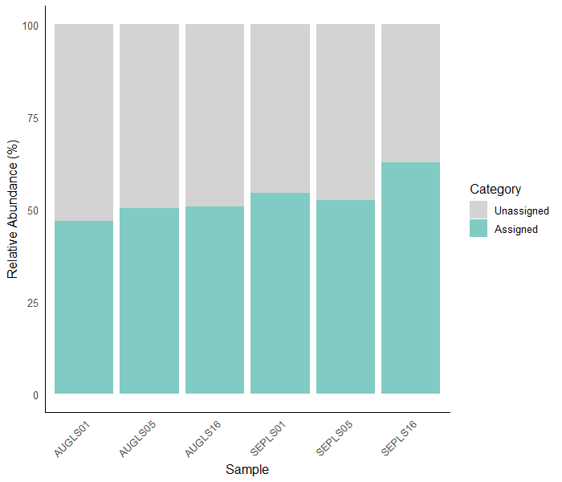
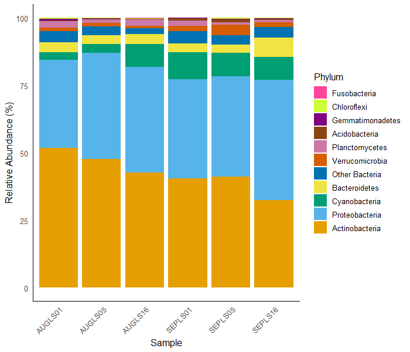

# mOTUs profiling
Microbial taxonomic profiling was performed using mOTUs v3.1.0, a tool that estimates the abundance of known and unknown microbial species based on single-copy phylogenetic marker genes ([Ruscheweyh et al., 2022](https://doi.org/10.1186/s40168-022-01410-z)). Reads were first mapped to the mOTUs marker gene database, and then the mapped reads were assigned to known microbial taxa. The abundance of each taxon, down to the genus level, was determined using the default counting algorithm. The relative abundance of each taxon was then calculated as the number of reads mapped to the taxon divided by the total number of mapped reads.

### Script: `motus_profile.sh`
- loops through the samples' clean reads in the `clean_reads/` folder
- runs ``bwa`` through ``motus profile`` against the mOTUs marker gene database and generates *.bam* files in the `taxo_profile/` folder.
- produces **relative abundance** data at phylum level in .txt format. `taxo_profile/phylum/profile_phylum.txt` contains the merged data for all samples.

```bash
#!/bin/bash

# List of sample names
samples=(AUGLS01 AUGLS05 AUGLS16 SEPLS01 SEPLS05 SEPLS16) 

# create the output folder
mkdir -p taxo_profile

# Loop through the clean reads for each sample
for sample in "${samples[@]}"; do
    echo "Processing $sample..."
    motus profile \
        -f "clean_reads/${sample}_1_cleaned.fastq.gz" \
        -r "clean_reads/${sample}_2_cleaned.fastq.gz" \
        -I "taxo_profile/${sample}.bam" \ # save BWA result as .bam file
        -t 8 \
	-k phylum \ # set taxonomic level
	-n "${sample}" \
	> "taxo_profile/phylum/${sample}_profile_phylum.txt"
done

# merge profiles per sample into a single text file
motus merge -d "taxo_profile/phylum" -o "taxo_profile/phylum/profile_phylum.txt"
```

### Create stacked barplot: `taxo_profile.R`
```r
# Load necessary library
library(readr)
library(tidyr)
library(dplyr)
library(ggplot2)
library(viridis)

#### Import and process data
# set '#' as indicator of the metadata lines in the motus output
# Clean the header of the motus output
{
  # Read file line by line
  lines <- readLines("taxo_profile/phylum/profile_phylum.txt")
  # Find the header line (starts with "#consensus_taxonomy")
  header_line <- grep("^#consensus_taxonomy", lines, value = TRUE)
  
  # remove leading '#'
  header <- gsub("^#", "", header_line)
  
  # Read the actual data, skipping metadata lines
  profile_phylum <- read_tsv(
    "taxo_profile/phylum/profile_phylum.txt",
    comment = "#",
    col_names = strsplit(header, "\t")[[1]]
  )
}

# Clean the dataframe i.e. remove those with 0 abundance
profile_phylum_clean <- profile_phylum %>%
  filter(!if_all(AUGLS01:SEPLS16, ~ .x == 0))%>%  # remove 
  mutate(consensus_taxonomy = if_else(consensus_taxonomy == "Bacteria phylum incertae sedis",
    "Other Bacteria", consensus_taxonomy)) %>%  # rename Bacteria phylum incertae sedis to Other bacteria
  rename(phylum = consensus_taxonomy)

# categorize assigned vs unassigned taxa
profile_wUnassigned <- profile_phylum_clean %>%
  mutate(phylum = if_else(phylum == "unassigned","Unassigned","Assigned"),
         across(
           .cols = -phylum,   # apply to all columns except phylum
           .fns = ~ .x * 100  # multiply each value by 100
           ))%>%
  group_by(phylum) %>%
  summarise(across(everything(), sum))

# Remove unassigned and readjust relative abundances
profile_assigned <- profile_phylum_clean %>%
  filter(phylum != "unassigned") %>%
  mutate(across(
    .cols = -phylum,          # apply to all columns except phylum
    .fns = ~ .x / sum(.x)*100     # divide each value by column total and convert to percent
  ))

#### Create stacked barplots

## Plot for assigned vs unassigned
# convert to long format
profile_wUnassigned_long <- pivot_longer(profile_wUnassigned, cols = -phylum, 
             names_to = "Sample", values_to = "Proportion")
#Set priority levels (what appears on top)
profile_wUnassigned_long$phylum <- factor(profile_wUnassigned_long$phylum, levels = c("Unassigned", "Assigned"))

ggplot(profile_wUnassigned_long, aes(x = Sample, y = Proportion, fill = phylum)) +
  geom_bar(stat = "identity") +
  scale_fill_manual(values = c("Assigned" = "#80CBC4", "Unassigned" = "#D3D3D3")) +
  labs(x = "Sample", y = "Relative Abundance (%)", fill = "Category") +
  theme_minimal(base_family = "sans", base_size = 12) +
  theme(legend.position = "right", 
        panel.grid.major = element_blank(),
        panel.grid.minor = element_blank(),
        axis.line = element_line(color = "black"),
        panel.border = element_blank(),
        panel.background = element_blank(),
        axis.text.x = element_text(angle = 45, hjust = 1))

## Plot for assigned phyla
# convert to long format
profile_assigned_long <- pivot_longer(profile_assigned, cols = -phylum, 
             names_to = "Sample", values_to = "Proportion")
#Set priority levels (what appears on top)
profile_assigned_long$phylum <- factor(profile_assigned_long$phylum,
                                  levels = rev(c("Actinobacteria", "Proteobacteria", "Cyanobacteria",
                                                 "Bacteroidetes", "Other Bacteria", "Verrucomicrobia",
                                                 "Planctomycetes", "Acidobacteria", "Gemmatimonadetes",
                                                 "Chloroflexi", "Fusobacteria")))

ggplot(profile_assigned_long, aes(x = Sample, y = Proportion, fill = phylum)) +
  geom_bar(stat = "identity") +
  scale_fill_viridis_d(option = "viridis") +
  labs(x = "Sample", y = "Relative Abundance (%)", fill = "Phylum") +
  theme_minimal(base_family = "sans", base_size = 12) +
  theme(
    legend.position = "right", 
    panel.grid.major = element_blank(),
    panel.grid.minor = element_blank(),
    axis.line = element_line(color = "black"),
    panel.border = element_blank(),
    panel.background = element_blank(),
    axis.text.x = element_text(angle = 45, hjust = 1)
  )

#### Output abundance tables
# Load necessary packages
library(xlsx)

# Create a new workbook
profile_phylum_wb <- createWorkbook()

# Add first sheet
sheet1 <- createSheet(profile_phylum_wb, sheetName = "Unassigned")
addDataFrame(as.data.frame(profile_wUnassigned), sheet1, row.names = FALSE, col.names = TRUE)

# Add second sheet
sheet2 <- createSheet(profile_phylum_wb, sheetName = "Assigned")
addDataFrame(as.data.frame(profile_assigned), sheet2, row.names = FALSE, col.names = TRUE)

# Save workbook
saveWorkbook(profile_phylum_wb, "profile_phylum.xlsx")

```
This R script produces two figures:

- `taxo_profile/figures/phyla_unassigned.png`


- `taxo_profile/figures/phyla_assigned.png`



The final block of code is used to output the abundance table: `taxo_profile/tables/profile_phylum.xlsx`.
