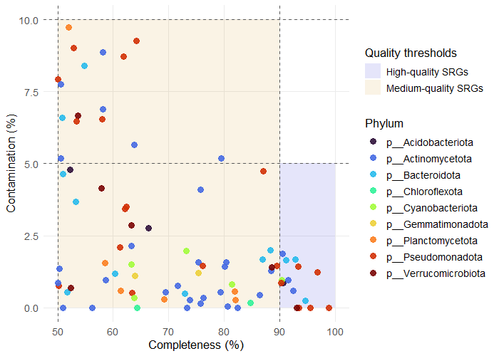
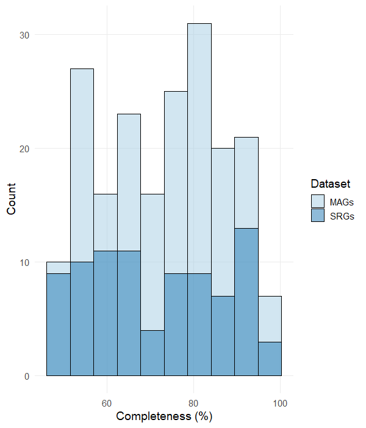
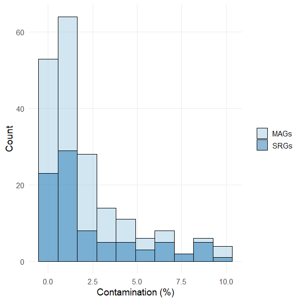
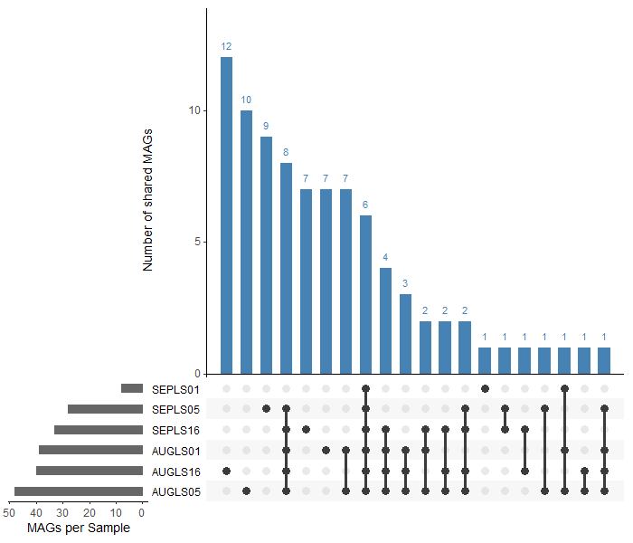

## Assembly
De novo assembly of clean short reads using *metaSPAdes* (Galaxy Version 3.15.5+galaxy2) on Galaxy EU was done individually for each sample i.e. in separate Galaxy histories (please also see https://github.com/lmfarinas/laguna-lake-ARG-Analysis/blob/main/ARC-Profiling-Workflow.md). The generated scaffolds were downloaded into the `scaffolds/` folder, with file names: [sampleName]_Scaffolds.fasta

#### Script: process_scaffolds.sh

Scaffolds were filtered (≥1000 bp). Assembly statistics were assessed using **seqkit stats** before and after filtering.
```bash
#!/bin/bash

# Set directories
input_dir="scaffolds"
output_stats="$input_dir/scaffolds_stats.txt"
filtered_dir="scaffolds_min1000"
filtered_stats="$filtered_dir/scaffolds_min1000_stats.txt"

# Create filtered output directory if it does not exist
mkdir -p "$filtered_dir"

# Initialize output stats files with headers
echo -e "sample\tfile\tformat\ttype\tnum_seqs\tsum_len\tmin_len\tavg_len\tmax_len" > "$output_stats"
echo -e "sample\tfile\tformat\ttype\tnum_seqs\tsum_len\tmin_len\tavg_len\tmax_len" > "$filtered_stats"

# Loop through all .fasta files
for fasta_file in "$input_dir"/*.fasta; do
    filename=$(basename "$fasta_file")
    sample="${filename%.*}"

    # Get stats for the original file
    stats=$(seqkit stats "$fasta_file" | tail -n +2)
    echo -e "$sample\t$stats" >> "$output_stats"

    # Filter sequences ≥1000 bp
    filtered_file="$filtered_dir/${sample}_min1000.fasta"
    seqkit seq -m 1000 "$fasta_file" -o "$filtered_file"

    # Get stats for the filtered file
    filtered_stats_line=$(seqkit stats "$filtered_file" | tail -n +2)
    echo -e "$sample\t$filtered_stats_line" >> "$filtered_stats"
done
```
Output files:

- `scaffolds/scaffolds_stats.txt` - stats before filtering
- `scaffolds_min1000/` - contains filtered fasta files: [sampleName]_Scaffolds_min1000.fasta
- `scaffolds_min1000/scaffolds_min1000_stats.txt` - stats after filtering

## Binning
The scaffolds were then binned using *MetaWRAP binning* (Galaxy Version 1.3.0+galaxy2) on Galaxy EU, which combines the binning and bin refinement modules of MetaWRAP (*NOTE: On Galaxy3, I think they separated the two modules already*).

Binning parameters were set to:
- Minimum % completion of bins (-c): 50
- Maximum % contamination of bins that is acceptable (-x): 10

This tool combines multiple tools into one pipeline. The binning module combines three binning tools: MaxBin2, metaBAT2, and CONCOCT. After which, it consolidates and refines binning using the refinement module. CheckM is used to evaluate bin completion and contamination, among other statistics.

For each of the samples, the following files were downloaded from Galaxy:

- Quality information of the final bins (on Galaxy history: MetaWRAP on collection #: stat files -> collection -> metawrap_50_10_bins) saved as `MAGs_stats/[sampleName]_metawrap_50_10_bins.tabular`
- Final/refined bins (on Galaxy history: MetaWRAP on collection #: bins -> collection) saved as `metawrap_50_10_bins/[sampleName]/`

Downloaded bins were renamed, appending the sample name before the bin name.
```bash
for sample_dir in metawrap_50_10_bins/*/; do 
    sample="$(basename "$sample_dir")" 
    for fasta_file in "$sample_dir"*; do 
        mv "$fasta_file" "$sample_dir${sample}.$(basename "$fasta_file")" 
    done
done
```

Using R, quality information of the MAGs (>=50 completeness, <=10 contamination) was combined into a single dataframe.

#### Script: summarize_mags_info.R (part 1)
```r
#Load packages:
library(dplyr)
library(stringr)
library(tidyr)
library(tidyverse)
library(xlsx)
library(ggplot2)
library(viridis)
library(UpSetR)

#### Summarize bin quality stats
# List all bin stat files
mags_stats_files <- list.files(path = "MAGs_stats", pattern = "\\.tabular$", full.names = TRUE)

# Import all .tsv files and combine into one data frame
mags_stats <- lapply(mags_stats_files, function(file) {
  sample_name <- str_split(basename(file), "_", simplify = TRUE)[1] # Extract sample name (everything before first "_")
  df <- read.delim(file, stringsAsFactors = FALSE) # Read file
  colnames(df)[1] <- "bin_number" # Rename 1st column to bin_number
  
  # Add sample_name as first column
  df <- df %>%
    mutate(sample_name = sample_name,
           bin_name = paste0(sample_name, ".", bin_number)) %>%
    select(sample_name, bin_number, bin_name, everything())
  
  return(df)
}) %>% bind_rows()

# Export MAGs quality containing genome, completeness, and contamination for dRep
mags_quality <- mags_stats %>%
  select(bin_name, completeness, contamination) %>%
  rename(genome = bin_name) %>%
  mutate(genome = paste0(genome, ".fasta"))

write.table(mags_quality,
            file = "mags_quality.csv",
            sep = ",",
            quote = FALSE,
            row.names = FALSE)
```
This portion of the script produces the `mags_quality.csv` file, which will be used by dRep for genome quality information (completeness and contamination only) and to skip CheckM.

Moreover, bin statistics were checked using `SeqKit v.2.10.0`. A temporary folder, `ALL_Samples/`, containing all the bin fasta files was created to simplify the bash script. Bin statistics were summarized into a .txt file as follows:

```bash
bins_dir="metawrap_50_10_bins/ALL_Samples"
bins_seqkit_stats="metawrap_50_10_bins/bins_seqkit_stats.txt"

# Write header
echo -e "sample\tfile\tformat\ttype\tnum_seqs\tsum_len\tmin_len\tavg_len\tmax_len\tQ1\tQ2\tQ3\tsum_gap\tN50\tN50_num\tQ20(%)\tQ30(%)\tAvgQual\tGC(%)\tsum_n" \
> "$bins_seqkit_stats"

# Loop through all .fasta files
for fa in "$bins_dir"/*.fasta; do
    [ -e "$fa" ] || continue

    fname=$(basename "$fa")

    # Extract sample name before first dot
    sample="${fname%%.*}"

    # Run seqkit stats, skip header, modify file field to basename
    seqkit stats -T -a "$fa" | tail -n +2 | \
    while IFS=$'\t' read -r file format type num_seqs sum_len min_len avg_len max_len Q1 Q2 Q3 sum_gap N50 N50_num Q20 Q30 AvgQual GC sum_n; do
        file_only=$(basename "$file")

        echo -e "${sample}\t${file_only}\t${format}\t${type}\t${num_seqs}\t${sum_len}\t${min_len}\t${avg_len}\t${max_len}\t${Q1}\t${Q2}\t${Q3}\t${sum_gap}\t${N50}\t${N50_num}\t${Q20}\t${Q30}\t${AvgQual}\t${GC}\t${sum_n}" \
        >> "$bins_seqkit_stats"
    done
done
```
The tab-delimited table is in `metawrap_50_10_bins/bins_seqkit_stats.txt`.

## Taxonomic Classification of MAGs
Classification of the MAGs was performed on the Galaxy EU server using the *GTDB-Tk Classify Genomes tool* (Galaxy version 2.4.1+galaxy0), with the *GTDB Full Database release 220* (2024-10-28) and default parameters.
This was also done in the separate Galaxy histories per sample, using the bins produced by MetaWRAP.

For each of the samples, the following file was downloaded from Galaxy:

- GTDB classification table (on Galaxy history: GTDB-Tk Classify genomes on collection # (summary)) saved as `gtdbtk_summary/[sampleName]_gtdbtk.bac120.summary.tsv`

The files were tabulated on R:

#### Script: summarize_mags_info.R (part 2)
```r
#### Summarize gtdb-tk files
# List all gtdb tsv files in the folder
gtdb_tsv_files <- list.files(path = "gtdbtk_summary", pattern = "\\.tsv$", full.names = TRUE)

# Import all .tsv files and combine into one data frame

gtdb_tsv <- lapply(gtdb_tsv_files, function(file) {
  sample_name <- str_split(basename(file), "_", simplify = TRUE)[1] # Extract sample name (everything before first "_")
  df <- read.delim(file, stringsAsFactors = FALSE) # Read file
  colnames(df)[1] <- "bin_number" # Rename 1st column to bin_number
  
  # Add sample_name as first column
  df <- df %>%
    mutate(sample_name = sample_name,
           bin_name = paste0(sample_name, ".", bin_number)) %>%
    select(sample_name, bin_number, bin_name, everything())
  
  return(df)
}) %>% bind_rows()
```

## Dereplication via dRep
All MAGs retrieved from all samples were dereplicated using `dRep v3.6.1`. The mags_quality.csv file was provided to skip the CheckM quality assessment step.
Quality filtering thresholds were set at *≥50% completeness and ≤10% contamination*, consistent with those used during MAG reconstruction with MetaWrap.
Primary clustering was performed at 90% average nucleotide identity (ANI), and secondary clustering at 95% ANI, enabling dereplication at the species level. The default dRep scoring method was applied to select the species representative genome (SRG) from each cluster.

```bash
dRep dereplicate drep_output \
  -g metawrap_50_10_bins/ALL/*.fasta \
  --genomeInfo mags_quality.csv \
  -comp 50 -con 10 \
  -pa 0.90 -sa 0.95 \
  -p 6
```

The output of drep is in `drep_out/` folder. I only uploaded the pertinent files that will be used for analysis.

## Summarize MAGs info
All the information on the MAGs generated from CheckM (in MetaWrap), dRep, and GTDB-Tk are organized in a single table.

The N50 values reported by CheckM (via MetaWrap) and dRep differed, although I am not sure why. I chose to report the N50 values calculated internally by dRep, since these were the values used for scoring and dereplication.

#### Script: summarize_mags_info.R (part 3)
```r
#### Combine Info
# Import information from seqkit stats output
seqkit_bin_stats <- read.table(file="metawrap_50_10_bins/bins_seqkit_stats.txt", header = TRUE, sep = "\t")

# Import pertinent data tables from drep_out
genomeInformation <- read.table(file = "drep_out/data_tables/genomeInformation.csv",
                                sep=",", header=TRUE)
widb <- read.table(file = "drep_out/data_tables/Widb.csv",
                   sep=",", header=TRUE)
cdb <- read.table(file = "drep_out/data_tables/Cdb.csv",
                   sep=",", header=TRUE)
sdb <- read.table(file = "drep_out/data_tables/Sdb.csv",
                  sep=",", header=TRUE)

# Combine information from metaWrap-checkM (mags_stats), seqkit (seqkit_bin_stats)
# dRep (genomeInformation), dRep (sdb), dRep (cdb), dRep (widb)
# and gtdb-tk (gtdb_tsv)
mags_info <- mags_stats %>%
  select(-lineage, -N50, -size) %>%  # remove info also found from gtdb-tk and drep
  rename(MetaWRAP_binner = binner) %>%
  # N50 values from checkm were different from seqkit and drep. Since drep used its internally calculated N50 for scoring, I chose to report it.
  # Moreover, drep's N50 is similar with seqkit, which calculates N50 including the N's of the scaffolds.
  # Add statistics from seqkit
  left_join(
    seqkit_bin_stats %>%
      mutate(bin_name = sub("\\.fasta$", "", file)) %>%
      rename(num_scaffolds = num_seqs, total_length = sum_len, min_length = min_len,
             avg_length = avg_len, max_length = max_len, scaffold_N50 = N50,
             scaffold_L50 = N50_num, total_N = sum_n) %>%
      select(bin_name, num_scaffolds, total_length, min_length, avg_length, max_length,
             scaffold_N50, scaffold_L50, total_N),
    by = "bin_name") %>%
  # Add other MAGs statistics from dRep (genomeInformation)
  left_join(
    genomeInformation %>%
      mutate(bin_name = sub("\\.fasta$", "", genome)) %>%
      select(bin_name, centrality),
    by = "bin_name") %>%
  # Add scoring from dRep (sdb)
  left_join(
    sdb %>%
      mutate(bin_name = sub("\\.fasta$", "", genome)) %>%
      select(bin_name, score),
    by = "bin_name") %>%
  # Add clustering info from dRep (cdb)
  left_join(
    cdb %>%
      mutate(bin_name = sub("\\.fasta$", "", genome)) %>%
      select(bin_name, secondary_cluster) %>% 
      rename(cluster = secondary_cluster),
    by = "bin_name") %>%
  # Identify SRGs through dRep(widb)
  mutate(is_SRG = bin_name %in% sub("\\.fasta$", "", widb$genome)) %>%
  mutate(SRGs = if_else(is_SRG, "★", "")) %>%
  select(-is_SRG) %>%
  # Add classification from gtdb-tk
  left_join(
    gtdb_tsv %>% select(bin_name, classification),
    by = "bin_name") %>%
  # Arrange by cluster and score
  separate(cluster, into = c("primary", "secondary"), sep = "_", convert = TRUE) %>%
  arrange(primary, secondary, desc(score)) %>%
  group_by(primary, secondary) %>%
  ungroup() %>%
  unite(cluster, primary, secondary, sep = "_", remove = TRUE)
```
#### Script: summarize_mags_info.R (part 4)

Export table `mags_info.xlsx` and save in `tables/` folder.
```r
#### create excel table - info on MAGs

# Create a new workbook
mags_info_wb <- createWorkbook()

# Add first sheet
sheet1 <- createSheet(mags_info_wb, sheetName = "sheet 1")
addDataFrame(as.data.frame(mags_info), sheet1, row.names = FALSE, col.names = TRUE)

# Save workbook
saveWorkbook(mags_info_wb, "mags_info.xlsx")
```

### Plots
The following were used to produce the figures for the analysis.

First, the SRGs were visualized on a % Contamination vs % Completeness plot. The thresholds for the quality classification of MAGs were based on MIMAG ([Bowers et al., 2017](https://www.nature.com/articles/nbt.3893)):
- High-quality MAGs: >90% completeness, <5% contamination.
- Medium-quality MAGs: >50% completeness, <10% contamination.
- Low-quality MAGs: <50% completeness, <10% contamination.

#### Script: summarize_mags_info.R (part 5)
```r
#### Plot
# get species representative genomes (SRGs) information
SRG_info <- genomeInformation %>%
  # keep only needed columns from genomeInformation
  select(genome, completeness, contamination, length, N50, centrality) %>%
  # keep only genomes that appear in widb (SRGs)
  semi_join(widb, by = "genome") %>%
  # attach SRG metadata from widb
  left_join(
    widb %>% select(genome, score, cluster, cluster_members),
    by = "genome"
  )

## generate Contamination vs Completeness for SRGs
gtdb_classification <- gtdb_tsv %>%
  select(bin_name, classification) %>%
  mutate(bin_name = paste0(bin_name, ".fasta")) %>%
  rename(genome = bin_name)

SRG_info_joined <- SRG_info %>%
  left_join(gtdb_classification, by = "genome") %>%
  separate(classification, into = c("domain", "phylum", "class", "order", "family", "genus", "species"), sep = ";", convert = FALSE)

# Define the quality regions as a data frame
quality_regions <- data.frame(
  xmin  = c(50, 90),
  xmax  = c(90, 100),
  ymin  = c(0, 0),
  ymax  = c(10, 5),
  quality = c("Medium-quality SRGs", "High-quality SRGs")
)

ggplot(SRG_info_joined, aes(x = completeness, y = contamination, color = phylum)) +
  # Background quality regions (with legend and actual transparency)
  geom_rect(
    data = quality_regions,
    aes(xmin = xmin, xmax = xmax, ymin = ymin, ymax = ymax, fill = quality),
    inherit.aes = FALSE,
    color = NA, alpha = 0.1
  ) +
  # Threshold lines
  geom_vline(xintercept = c(50, 90), linetype = "dashed", color = "grey35") +
  geom_hline(yintercept = c(10, 5),   linetype = "dashed", color = "grey35") +
  # Points
  geom_point(size = 3, alpha = 0.9) +
  labs(
    x = "Completeness (%)",
    y = "Contamination (%)",
    color = "Phylum",
    fill  = "Quality thresholds"
  ) +
  scale_x_continuous(limits = c(50, 100)) +
  # Colors for fills and points
  scale_color_viridis_d(option = "turbo") +
  scale_fill_manual(
    values = c("Medium-quality SRGs" = "orange3", "High-quality SRGs" = "blue3")
  ) +
  theme_minimal() +
  theme(
    text = element_text(size = 13),
    panel.grid.minor = element_blank()
  )
```
The generated plot, `SRGs_quality_plot.png`, is a shown:



Then, to visualize the quality based on completeness and contamination of the MAGs and the SRGs, overimposed plots for completeness and contamination were made.

#### Script: summarize_mags_info.R (part 6)
```r
## generate Completeness and Contamination plot for MAGs and SRGs
# combine info for All MAGs and SRGs
SRGs_MAGs_combined <- bind_rows(
  genomeInformation %>% mutate(dataset = "MAGs") %>% select(genome, completeness, contamination, dataset),
  SRG_info %>% mutate(dataset = "SRGs") %>% select(genome, completeness, contamination, dataset)
)

# Plot for completeness
ggplot(SRGs_MAGs_combined, aes(x = completeness, fill = dataset)) +
  geom_histogram(position = "identity", alpha = 0.5, bins = 10, color = "black") +
  scale_fill_manual(values = c("MAGs" = "#a6cee3", "SRGs" = "#1f78b4")) +
  labs(
    x = "Completeness (%)",
    y = "Count",
    fill = NULL
  ) +
  theme_minimal(base_size = 14) +
  theme(
    legend.position = "right",
    panel.grid.minor = element_blank()
  )

# Plot for contamination
ggplot(SRGs_MAGs_combined, aes(x = contamination, fill = dataset)) +
  geom_histogram(position = "identity", alpha = 0.5, bins = 10, color = "black") +
  scale_fill_manual(values = c("MAGs" = "#a6cee3", "SRGs" = "#1f78b4")) +
  labs(
    x = "Contamination (%)",
    y = "Count",
    fill = NULL
  ) +
  theme_minimal(base_size = 14) +
  theme(
    legend.position = "right",
    panel.grid.minor = element_blank()
  )
```

- `completeness_MAGs.png`


- `contamination_MAGs.png`


Finally, to illustrate the number of MAGs originating from each sample and the SRGs shared among samples, an UpSet plot was generated. An SRG was considered shared between samples A and B if it belonged to a cluster containing MAGs derived from both samples.

#### Script: summarize_mags_info.R (part 7)
```r
## upset plot for Shared SRGs
# make wide boolean matrix (samples = columns, clusters = rows)
cluster_matrix <- mags_info %>%
  select(sample_name, cluster) %>%
  mutate(present = 1) %>%
  pivot_wider(names_from = sample_name, values_from = present, values_fill = 0)

# sample columns (all except cluster)
samples <- setdiff(colnames(cluster_matrix), "cluster")

UpSetR::upset(
  as.data.frame(cluster_matrix),
  sets = samples,
  nintersects = NA,   # how many intersections to show (top 30)
  order.by = "freq",   # order by most common intersections
  main.bar.color = "steelblue",
  sets.bar.color = "gray40",
  point.size = 3,
  line.size = 1.2,
  text.scale = 1.3,
  mainbar.y.label = "Number of shared MAGs",  # top bars
  sets.x.label = "Shared SRGs",       # left bars
)
```

